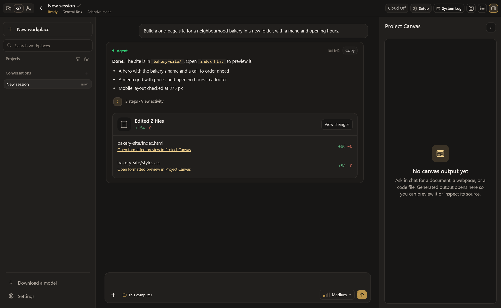
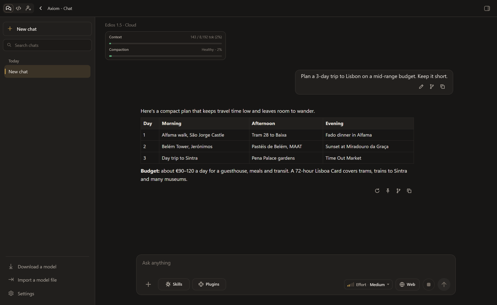
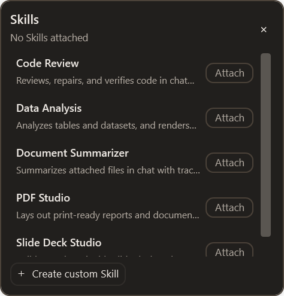
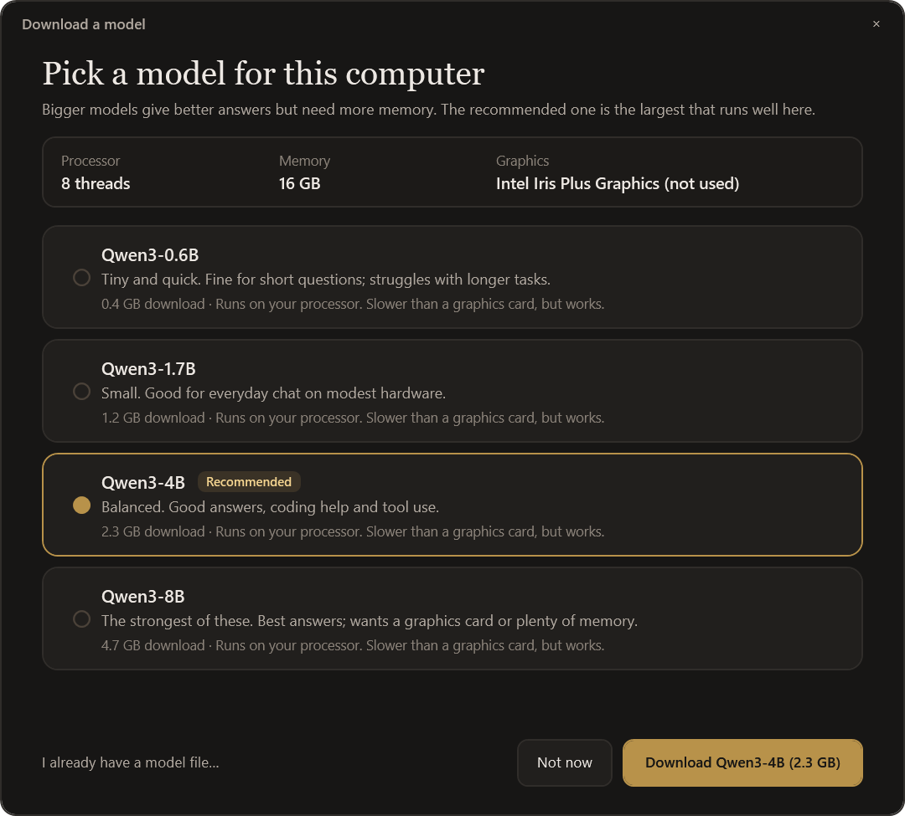

# Axiom

**A native Windows AI workspace: run models on your own PC, on your own server, or in the cloud.**

### [⬇ Download Axiom for Windows](https://github.com/YoMosa2009/Axiom/releases/latest)

Free with local models or your own key · Code-signed installer · Windows 10/11 (64-bit)

[Getting started](#getting-started) · [Changelog](CHANGELOG.md) · [Privacy](PRIVACY.md) · [Terms](TERMS.md) · [Feedback](#feedback)

---

## Why Axiom

- **Native, not a web wrapper.** C# and WPF on .NET 10, with no Electron.
- **Your model, your choice.** The same features work on a local GGUF model, your own
  OpenAI-compatible server, or the cloud.
- **Adapts to small models.** Axiom measures the model you load and scales prompts, tools and
  budgets so a 1B model still gives usable results.
- **Private by default.** Chats, keys and models stay on your PC. Anonymous diagnostics can be
  switched off in Settings (see [PRIVACY.md](PRIVACY.md)).

## Three ways to run a model

| | Runs on | You need |
|---|---|---|
| **Local** | Your GPU or CPU (llama.cpp) | A GGUF model; the first-run guide can download one that fits |
| **Hybrid Local** | Your own server | Any OpenAI-compatible endpoint |
| **Cloud** | Axiom Cloud or OpenRouter | An optional Axiom Cloud subscription, or your own OpenRouter key |

## What's inside

**Chat.** One conversation with every tool: attachments with previews, web search, a Python
sandbox, calculator, Skills and Plugins, and Persona notes that give the model background about
you. Type `@ProjectCanvas` to render an answer as a live HTML, SVG or Markdown artifact beside the
chat.

**Workplace.** For work that takes more than one pass.
- **Single Model:** one agent plans, uses tools and checks its own result.
- **Council:** a Builder does the work; at Extra High and Ultra Axiom checks the result and has it fixed.
- **Agent Access:** a terminal-style agent that runs commands and reads and writes files in a
  folder you pick. Every run ends with its steps, a file-change summary and one-click **Undo**.
  You choose Manual (approve each change) or Auto.
- **Browser actions:** the agent can open pages and click or fill controls, each with your
  approval. It never presses payment or account-closing buttons.
- **`@ComputerUse`:** drives the desktop with a vision model, checking each action landed.

**Skills.** Reusable procedures you attach once, everywhere. Some answer in chat; others produce
a finished artifact, such as a slide deck, a print-ready PDF or a charted report. On small models
Axiom builds the artifact itself from the model's outline.

**Effort.** Pick Light to Ultra per message. Higher levels think longer and allow more tool
rounds and time per step. Extra High checks the result (runs it, validates files) and fixes what
the checks find; Ultra adds a fresh review of the finished work.

**Reply as context.** Right-click any AI reply, or select part of it and press Ctrl+Shift+L, to
attach it to your next message. It shows as a short quote above the input box.

**Themes.** Switch themes in Settings › General without restarting.

## Cloud models

| Profile | Model | Use |
|---|---|---|
| **Edios 1.5** | Google Gemma 4 31B (free) | General chat, documents, tools |
| **Hepha 2.5 Coder** | NVIDIA Nemotron 3 Ultra (free) | Coding |
| **Threnody 1.0** | DeepSeek V4.1 Flash | Long context, vision |
| **Workplace** | NVIDIA Nemotron 3.5 Super VL (free) | Every Workplace cloud run |
| **Kestral 1** | Your own endpoint | Hybrid Local |

Workplace uses exactly one cloud model with no silent fallback, so every step of a run uses the
same model.

---

## Getting started

1. Download **`Axiom-Setup-…-win-x64.exe`** from the
   [latest release](https://github.com/YoMosa2009/Axiom/releases/latest) and run it. It is
   code-signed and installs for your account only, with no admin prompt. (Or download the
   `…-clean.zip`, extract the whole folder and run `Axiom Harness.exe`.)
2. The first-run guide checks your hardware, shows which local models fit and downloads one, or
   lets you set up a cloud key or your own server.

   

3. Open **Chat**, or head to **Workplace**.

**Updates** install from inside the app (Settings › General › Check for updates). Your chats,
settings and models are kept. Your data lives in `%LOCALAPPDATA%\Axiom`, never in the install
folder, so every new install starts empty.

**Requirements:** Windows 10 or 11 (64-bit), 4 GB RAM (16 GB recommended for local models),
optional NVIDIA GPU for faster local models.

---

## Feedback

- **In the app:** Settings › General › **Send feedback** (adds your app version and recent error
  lines; never your chats, files or keys).
- **On GitHub:** [open an issue](https://github.com/YoMosa2009/Axiom/issues/new/choose). Issues are
  public, so leave out keys and personal files.
- **By email:** malxshrouds@gmail.com

## Contributing

Fork the repo, work on a branch and open a pull request; every change is reviewed before it is
merged. See [CONTRIBUTING.md](CONTRIBUTING.md). Report security problems privately as described in
[SECURITY.md](SECURITY.md).

## License

[PolyForm Noncommercial 1.0.0](LICENSE): use, study, change and share Axiom for any noncommercial
purpose, keeping the license and copyright notice. Releases before V1.11.0 were published under
CC BY-NC-ND 4.0. The author ([YoMosa2009](https://github.com/YoMosa2009)) keeps the right to
distribute official builds commercially and to run paid hosted services such as Axiom Cloud.
Third-party commercial use needs written permission; see
[CONTRIBUTING.md](CONTRIBUTING.md#licensing-of-contributions).

Built by [YoMosa2009](https://github.com/YoMosa2009) ·
[MalxLabs.work](https://malxlabs.work) · [Axiominference.work](https://axiominference.work/)

